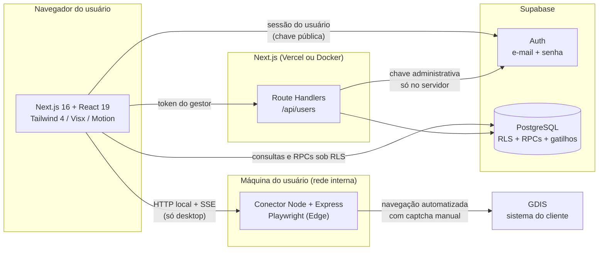

# Diagrama 01 — Arquitetura (verificado em código e `CONTEXTO_GERAL.md` §2)

Apenas componentes confirmados. O app Android e a Central NEO são projetos separados que consomem o mesmo banco; ficam fora do diagrama.

Leitura: a maior parte da regra de negócio mora no banco (RPCs, gatilhos, políticas de linha). O servidor Next.js só entra na gestão de usuários, onde é necessária a chave administrativa.
