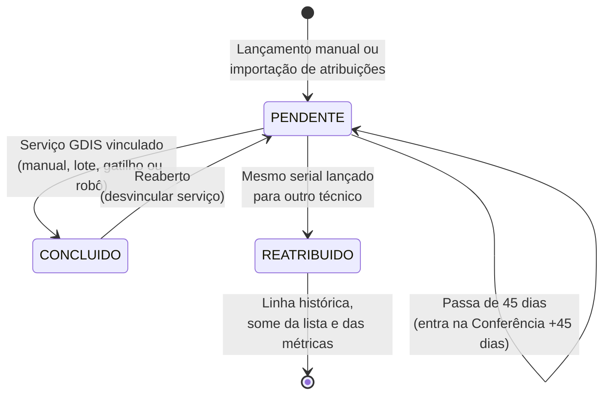

# Diagrama 02 — Ciclo de vida do medidor (verificado em `CONTEXTO_GERAL.md` §6 a §10 e migrations)

Regras associadas (confirmadas): um serial só pode ter uma linha `PENDENTE` (índice único parcial); vincular serviço sempre conclui o medidor; cada mudança grava um evento no log do medidor por gatilho.
